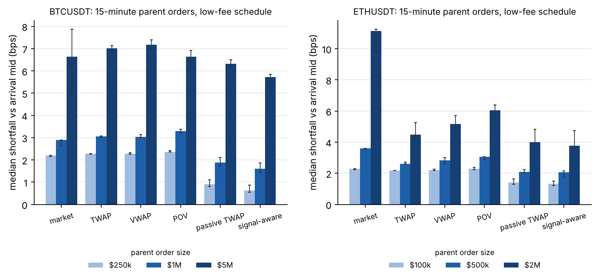
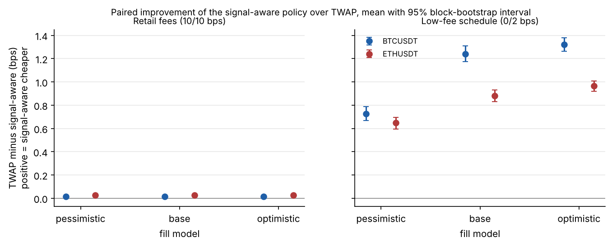
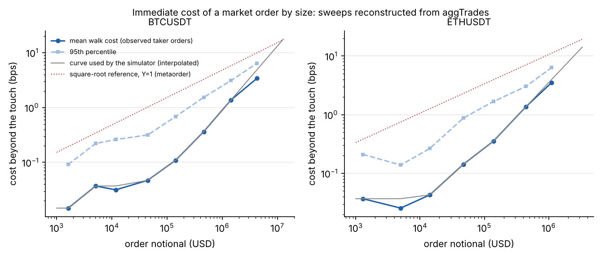

# ExecLab

**Does short-horizon order-flow information reduce the cost of executing a large order, and by how much once you are honest about fills, fees and uncertainty?**

An event-driven execution simulator that replays Binance BTCUSDT and ETHUSDT trades, overlays a parent order, and compares market, TWAP, VWAP, participation, Almgren-Chriss and a model-driven passive/aggressive policy on implementation shortfall. Every headline number is out of sample (walk-forward by day), shown under three fill assumptions, and comes with a block-bootstrap interval. Validation and the trial ledger come from [Skeptic](https://github.com/OWNER/skeptic).

## Key findings

Data: 5.0 million Binance spot trades (BTCUSDT and ETHUSDT, 27 to 29 October 2026). Each parent order is bought or sold over 15 minutes, starting every 20 minutes, on days the models never saw: **852 parent orders per symbol**. Intervals are 95% block-bootstrap intervals by hour.

1. **Who you pay decides the answer.** At Binance's base fee tier (10 bps for both makers and takers), fees are 10 bps of every strategy's total cost. Resting passively saves nothing on fees but picks up adverse selection, so a naive passive TWAP is **0.34 bps (BTC) and 0.58 bps (ETH) worse** than plain TWAP. The model learns this and rests on only **3 to 4%** of its decisions; it beats TWAP by just **0.015 bps** (BTC, 0.012 to 0.017) and **0.027 bps** (ETH, 0.021 to 0.035). Its value at these fees is knowing when *not* to rest.
2. **On a maker-friendly schedule the policy pays, but mostly for a boring reason.** With an illustrative 0 bps maker / 2 bps taker schedule, the signal-aware policy beats TWAP by **1.24 bps** for BTC (1.18 to 1.31) and **0.88 bps** for ETH (0.83 to 0.93) under the base fill model. Most of that is the fee rebate any passive schedule earns: a naive passive TWAP gets **1.00** and **0.72 bps** of it.
3. **The model's own contribution is small, real, and survives pessimistic fills.** Over the naive passive TWAP on identical orders, the model adds **0.24 bps** for BTC (0.20 to 0.28) and **0.16 bps** for ETH (0.13 to 0.20). Under the pessimistic fill model (filled only when the price trades through) the gain is **0.36** and **0.20 bps**; under the optimistic one, **0.21** and **0.14 bps**. On the low-fee schedule it is cheaper on 80 to 84% of individual orders under every fill model.
4. **Negative result: a 1-second signal that dies on fees.** The most confident 1% of 1-second direction calls are right **94%** (BTC) and **77%** (ETH) of the time, but earn only **0.47 bps** (0.42 to 0.53) and **0.46 bps** per trade before costs, against a round trip of 20 bps at retail fees and 4 bps on the low-fee schedule. Some of that apparent edge may also be bounce in the trade-inferred quotes.
5. **When does a market order hurt?** Reconstructed taker sweeps show the cost beyond the touch: about **0.1 bps** for a $100k to $300k BTCUSDT order, **1.4 bps** for $1M to $3M and **3.4 bps** for $3M to $10M (only 7 orders). One order in twenty pays more than 1 bp from **$300k** in BTCUSDT and from **$100k** in ETHUSDT. ETHUSDT's price response to signed flow is concave (exponent **0.45**, 95% interval 0.37 to 0.65, close to the square-root reference); BTCUSDT's cannot be told apart from linear (**0.91**, 0.63 to 1.33).

## Charts

More: [intraday fact sheet](reports/factsheet.png), [fill-probability calibration](reports/fill_calibration.png), [Almgren-Chriss frontier](reports/ac_frontier.png), [data quality report](reports/data_quality.md).

## Method

**Data and quotes.** Historical Binance files carry each trade's aggressor side but no order book, so the best bid and ask are inferred from the latest seller- and buyer-initiated prints, with a staleness rule so the proxy never crosses. Both pairs trade at one tick most of the time (94% of seconds for BTCUSDT, 90% for ETHUSDT). **Cost curve:** consecutive prints with the same timestamp and side are one taker order sweeping the book, so their VWAP against the first fill price is the walk cost for that size. The simulator interpolates the bucket means in log-log space. **Simulator:** a numba-compiled event loop replays trades in 5-second decision steps. Crossing pays the touch plus the walk cost; our own trading adds 3.7 bps (BTC) or 6.3 bps (ETH) of impact per $1M executed, taken from regressing mid changes on signed flow and decaying with a 5-minute half-life (an assumption, varied below). Passive orders fill only from replayed opposite-side prints under three **fill models**: *pessimistic* (filled only when the price trades through), *base* (join the back of a queue sized from observed level depletion) and *optimistic* (front of the queue). Every parent order must finish: anything left at the deadline crosses. **Shortfall** is measured against arrival mid and split into spread, impact, delay, fees and opportunity cost. **Signal-aware policy:** at each step it compares the predicted cost of resting (fill probability, from an XGBoost classifier, and the drift paid when unfilled, from an XGBoost regressor) against crossing now, on a TWAP schedule. **Validation:** walk-forward by day (day 1 trains for day 2, days 1 to 2 train for day 3); Optuna tuning uses Skeptic's purged walk-forward splits with an embargo equal to the label horizon, and all 160 tuning trials are in the ledger.

## The ML layer

| Target (test day) | Prior | Logistic | XGBoost |
|---|---|---|---|
| Passive bid filled within 5s, BTCUSDT (log loss) | 0.702 | 0.639 | **0.618** |
| Passive bid filled within 5s, ETHUSDT (log loss) | 0.710 | 0.633 | **0.614** |
| 5s mid direction, 3 classes, BTCUSDT (accuracy) | 41.8% (majority) | 54.6% | **56.0%** |
| 5s mid direction, 3 classes, ETHUSDT (accuracy) | 24.3% (majority) | 49.3% | **50.6%** |

- **Calibration:** the fill model is close to the diagonal on the test day ([chart](reports/fill_calibration.png)).
- **Ablation:** dropping the volatility features costs the most (+0.010 log loss for BTC, +0.013 for ETH); the clock features add nothing.
- **Cross-asset:** the BTC-trained fill model scores 0.643 on ETH, against 0.614 for the ETH-trained model and 0.710 for the prior, so most of what it learned transfers.
- **Deep model:** the GRU/1D-CNN step was not run: the tree model's edge over logistic is already small, and the spec's rule was to keep a deep model only if it beat the trees after costs.

## What failed, and what depends on assumptions

- **Market order versus slicing depends on self-impact, which public data cannot measure.** For a $5M BTCUSDT order (low-fee schedule), immediate execution costs 6.5 bps on average. TWAP costs 7.0 bps with the 5-minute impact half-life, 2.1 bps with no self-impact, and 11.0 bps if impact is permanent, so the ranking flips with the assumption and I do not claim either way. For ETHUSDT at $2M, slicing wins under all three (market 10.6 bps; TWAP 4.9, 2.1 or 7.1).
- **Almgren-Chriss** behaves as theory says: front-loading a $5M BTC order cuts the spread of outcomes across orders from 11.7 to 3.3 bps, at a cost of 2.8 bps on average ([frontier](reports/ac_frontier.png)). Whether that trade is worth it is a risk-appetite question, not a modelling one.
- **VWAP** was no better than TWAP (within 0.02 bps for BTC, worse for ETH): one or two training days are not enough to estimate an intraday volume profile.

## Limitations

- **Three days.** Two out-of-sample days, two symbols, one market regime. Intervals are by hour within those days, so they understate day-to-day variation. More days (`make full` picks up any aggTrades zips in `../data/binance`) are the obvious next step.
- **No order book.** Queue position and depth come from trades, not the book. The L2 recorder below exists to fix that; it has not been run for long enough to use yet.
- **Self-impact is assumed**, and varied.
- **Fee schedules.** "Retail" is Binance's base spot tier (0.1% maker and taker); the "low-fee" 0/2 bps schedule is illustrative, not a specific Binance tier.

## Live L2 recorder

`python -m execlab.recorder --symbols BTCUSDT ETHUSDT --levels 20` (or `make record`) streams depth diffs and trades over Binance's public websocket, rebuilds each book with the documented snapshot-plus-diff procedure, checks update-ID continuity, resynchronises on any gap, and writes zstd Parquet partitioned by symbol and date with both exchange and local receive timestamps. `make quality` reports gaps, resyncs, crossed books, clock offset and event rates. The book logic is unit-tested (gap detection, stale events, a property test that consistent updates never cross the book); the recorder itself needs a machine that can reach Binance for 2 to 4 weeks.

## Engineering

- **Tests:** 12 tests including the **no-lookahead test** (every strategy, under every fill model, takes identical actions on data truncated at time t and on the full data, up to t), hypothesis property tests (parent orders always complete and never overfill, cash and inventory reconcile, the shortfall decomposition adds up) and a feature test that features computed on truncated data match.
- **Performance:** the numba replay runs **20,900 parent orders a second** (3.8 million decision steps a second) against 376 a second for the same loop in pure Python, a **55x** speed-up, on one core ([benchmark](reports/benchmark.json)).
- `ruff` and `mypy` clean, GitHub Actions CI, Dockerfile.

## Reproduce

| Command | What it does |
|---|---|
| `make data` | download the three days of Binance aggTrades used here (public, no API key) |
| `make test` | unit, property and no-lookahead tests |
| `make reproduce` | the headline charts from a checked-in 2-hour sample, in under a minute |
| `make full` | the full study on aggTrades zips in `../data/binance` (about an hour on 2 cores; trained models are cached) |
| `make record`, `make quality` | run the L2 recorder; report on its data |

## Research note

[Does order flow information reduce execution cost? Evidence from BTCUSDT and ETHUSDT](docs/note.pdf) (6 pages).

## How this would transfer to FX and rates

The shortfall decomposition, fill-model framing and validation protocol carry over unchanged. What changes is the data: FX and rates have no public prints, so the queue and fill models would be estimated from a desk's own fills, last-look outcomes and RFQ responses. The fee lesson becomes a spread lesson: in dealer markets, resting versus crossing is about information leakage and hit rates, not maker rebates. The [AUD Cost Atlas](https://github.com/OWNER/aud-cost-atlas) covers the FX side with public quotes.

## References

Almgren, R. and Chriss, N. (2000). Optimal execution of portfolio transactions. *Journal of Risk*.
Bouchaud, J.-P., Bonart, J., Donier, J. and Gould, M. (2018). *Trades, Quotes and Prices*. Cambridge.
Cont, R., Kukanov, A. and Stoikov, S. (2014). The price impact of order book events. *Journal of Financial Econometrics*.
Stoikov, S. (2018). The micro-price. *Quantitative Finance*.
Toth, B. et al. (2011). Anomalous price impact and the critical nature of liquidity in financial markets. *Physical Review X*.
Zhang, Z., Zohren, S. and Roberts, S. (2019). DeepLOB. *IEEE Transactions on Signal Processing*.
