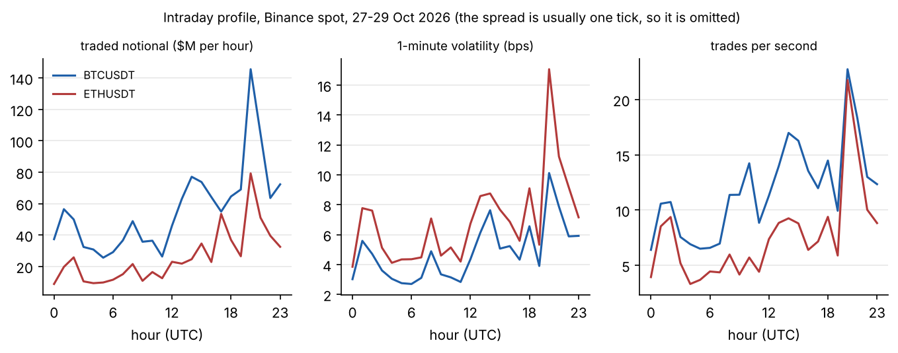
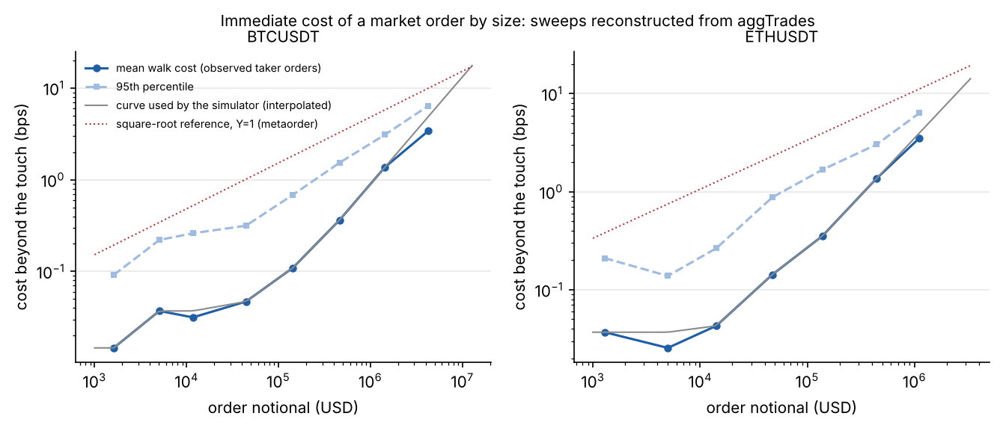
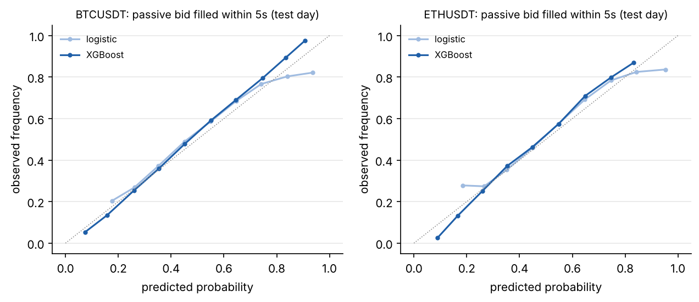
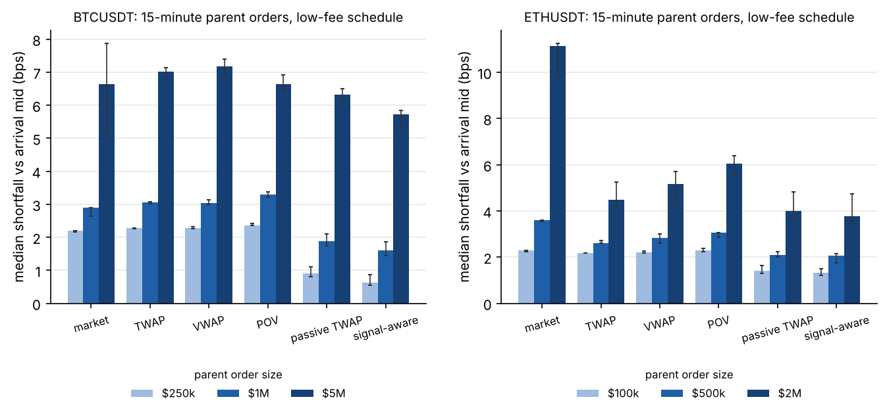
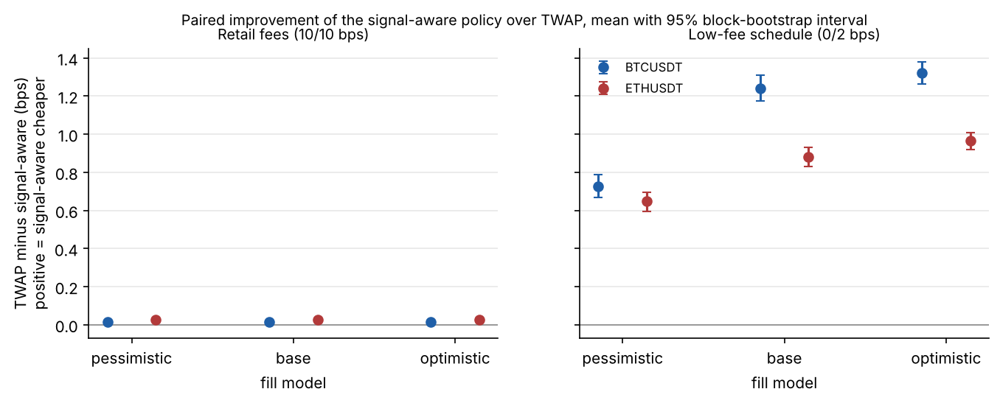
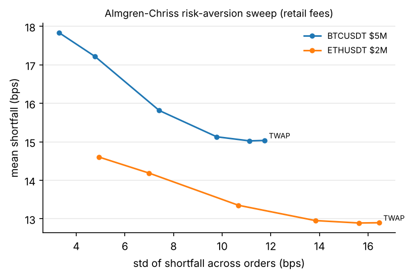

# Does order flow information reduce execution cost? Evidence from BTCUSDT and ETHUSDT

*Athish Shubhan, October 2026. Research note accompanying ExecLab.*

## Summary

A trader who must buy or sell a large amount within a deadline chooses, at every moment, between crossing the spread now and resting a passive order that may or may not fill. This note asks whether short-horizon information from the order flow helps make that choice, measured in basis points of implementation shortfall on parent orders the models never saw. On three days of Binance spot trades in BTCUSDT and ETHUSDT, the answer depends mostly on the fee schedule. When makers and takers pay the same fee, a model-driven policy learns to rest almost never, and its gain over TWAP is a few hundredths of a basis point. On a maker-friendly schedule it beats TWAP by about 1 bp, but most of that is the fee saving any passive schedule earns; the part attributable to the model is 0.16 to 0.24 bps, which survives a pessimistic fill model. A one-second direction signal that is right 94% of the time on its most confident calls earns less than half a basis point per trade before fees.

## 1. Data and the quote problem

The data are Binance spot aggregated trades for BTCUSDT and ETHUSDT from 27 to 29 October 2026: 3.05 million and 1.97 million trades, with no gaps in trade IDs and no out-of-order timestamps. Each trade records its aggressor side, so no classification heuristic is needed. The historical files do not include the order book, so the best bid and ask are inferred: the latest seller-initiated print bounds the bid and the latest buyer-initiated print bounds the ask. A staleness rule keeps the proxy from crossing. Both pairs trade at a single tick (0.01 USDT) most of the time, 94% of seconds for BTCUSDT and 90% for ETHUSDT, which at prices near 80,000 and 2,300 USDT is a spread of about 0.001 and 0.04 bps. The spread is close to free; fees and size are what cost money.

Activity and volatility peak around 20:00 UTC, the US equity close, and are lowest in the Asian morning. A live L2 recorder (snapshot plus diff, with update-ID continuity checks and automatic resynchronisation) is part of the repository; running it for several weeks would replace the inferred quotes with the real book.

## 2. What a market order costs

Binance prints a market order that sweeps several price levels as several aggregated trades with the same timestamp and side. Grouping them reconstructs each taker order, and its average price against the first fill gives the cost of walking the book for that size.

For BTCUSDT the mean walk cost is about 0.1 bps for orders of $100k to $300k, 1.4 bps for $1M to $3M, and 3.4 bps for the seven orders between $3M and $10M. One order in twenty pays more than 1 bp from $300k in BTCUSDT and from $100k in ETHUSDT, which is a reasonable working definition of "uncomfortable". These are costs of orders that other traders *chose* to send, presumably when the book was deep enough, so they understate the cost of sweeping the same size blindly.

Separately, regressing one-minute mid-price changes on signed taker notional gives a price-response curve. For ETHUSDT it is concave, with an exponent of 0.45 (95% interval 0.37 to 0.65 from resampling hours), close to the square-root law. For BTCUSDT the exponent is 0.91 (0.63 to 1.33), which cannot be distinguished from linear on three days. Public data shows how prices respond to the market's flow, not to one participant's metaorder, so the square-root law is a reference, not something this confirms.

## 3. The simulator

A parent order of fixed notional must complete within 15 minutes, with a decision every 5 seconds. Orders start every 20 minutes on each test day, in both directions and at three sizes ($250k, $1M, $5M for BTCUSDT; $100k, $500k, $2M for ETHUSDT), giving 852 parent orders per symbol. Because every buy has a matching sell at the same moment, market drift cancels in averages and the comparisons isolate execution cost.

**Crossing** pays the inferred touch plus the walk cost for the child order's size. **Our own impact** adds 3.7 bps (BTC) or 6.3 bps (ETH) per $1M we have executed, the slope from the price-response regression, decaying with a five-minute half-life. This is the least defensible input in the study, so Section 6 varies it. **Passive orders** fill only from replayed prints on the other side, under three fill models: *pessimistic* (filled only when the price trades through our level), *base* (we join the back of a queue sized from how much volume levels absorb before they are traded through) and *optimistic* (front of the queue). Anything unfilled at the deadline crosses, so every parent order finishes. Shortfall is measured against the arrival mid and split into spread, impact, delay, fees and opportunity cost; a reconciliation test checks that the components add up to the cash actually spent.

Strategies: an immediate market order; TWAP; VWAP (profile from training days); percent of volume; Almgren-Chriss with a risk-aversion sweep; a naive passive TWAP that rests each slice at the touch; and the signal-aware policy.

## 4. The signal-aware policy and its models

At each step the policy compares the cost of crossing now (half-spread, walk cost and taker fee) with the expected cost of resting for one step. If the resting order fills, the trader earns the half-spread and pays the maker fee. If it does not, the trader pays whatever the price drifted in the meantime and crosses later. Two models supply the inputs: an XGBoost classifier for the probability that a resting order at the touch fills within 5 seconds, and an XGBoost regressor for the drift paid when it does not. The two are trained on one-second features of the recent tape: signed flow over several windows, trade activity, recent returns, realised volatility, time since the last price change and volume printed at the touch.

Models are trained walk-forward by day: day 1 trains the policy for day 2, days 1 and 2 for day 3. Hyperparameters are tuned with Optuna on Skeptic's purged walk-forward splits, with an embargo equal to the label horizon, and all 160 trials are logged to its ledger.

| Test day | Prior | Logistic | XGBoost |
|---|---|---|---|
| Fill within 5s, BTCUSDT (log loss) | 0.702 | 0.639 | 0.618 |
| Fill within 5s, ETHUSDT (log loss) | 0.710 | 0.633 | 0.614 |

The fill model is well calibrated out of sample. Dropping the volatility features hurts it most; the time-of-day features add nothing. A model trained on BTCUSDT and tested on ETHUSDT keeps most of the gain (log loss 0.643, against 0.614 for the ETHUSDT model and 0.710 for the prior).

## 5. Results

**Equal fees (Binance base tier, 10 bps maker and taker).** Fees are 10 bps of every strategy's cost, and resting cannot save any of it. Resting does attract adverse selection: a naive passive TWAP is 0.34 bps (BTC) and 0.58 bps (ETH) more expensive than TWAP. The signal-aware policy learns to rest on only 3 to 4% of its decisions, and beats TWAP by 0.015 bps (BTC, 95% interval 0.012 to 0.017) and 0.027 bps (ETH, 0.021 to 0.035). Its value is in not resting.

**Maker-friendly schedule (illustrative: 0 bps maker, 2 bps taker).** Now the policy rests on 75 to 91% of decisions and beats TWAP by 1.24 bps (BTC, 1.18 to 1.31) and 0.88 bps (ETH, 0.83 to 0.93) under the base fill model.

The fair benchmark for the model is the naive passive TWAP, which collects the same fee saving without any prediction. Against it, on identical orders:

| Model's gain over naive passive TWAP (bps, low-fee) | Pessimistic | Base | Optimistic |
|---|---|---|---|
| BTCUSDT | 0.36 (0.29 to 0.42) | 0.24 (0.20 to 0.28) | 0.21 (0.17 to 0.25) |
| ETHUSDT | 0.20 (0.15 to 0.24) | 0.16 (0.13 to 0.20) | 0.14 (0.11 to 0.17) |

The gain is largest under the pessimistic fill model, where knowing when a resting order will not fill matters most, and the model is cheaper on 80 to 84% of individual orders in every case. This is the "small, real, fragile" result the project expected, except that it is not fragile to the fill assumption. It is fragile to the fee schedule, and it rests on two test days.

**A negative result.** The direction model's most confident 1% of one-second calls are right 94% of the time for BTCUSDT and 77% for ETHUSDT, but the moves are tiny: 0.47 bps (0.42 to 0.53) and 0.46 bps per trade before costs, against a round trip of 20 bps at retail fees or 4 bps on the low-fee schedule. Part of that apparent accuracy may be bounce in the trade-inferred quotes. As a standalone strategy it loses an order of magnitude more than it makes; as an input to execution it is worth a fraction of a basis point.

## 6. Robustness and what depends on assumptions

**Self-impact.** For a $5M BTCUSDT order on the low-fee schedule, an immediate market order costs 6.5 bps on average. TWAP costs 7.0 bps with the five-minute impact half-life, 2.1 bps with no self-impact and 11.0 bps if impact is permanent. Whether to slice a large BTCUSDT order therefore depends on an input public data cannot pin down, and the study does not take a side. For a $2M ETHUSDT order slicing wins under all three assumptions (10.6 bps for the market order against 4.9, 2.1 or 7.1 for TWAP).

**Risk.** Almgren-Chriss front-loading behaves as theory predicts. For a $5M BTCUSDT order, raising risk aversion cuts the standard deviation of shortfall across orders from 11.7 to 3.3 bps, at a cost of 2.8 bps on average.

**Lookahead.** A test runs every strategy, under every fill model, on data truncated at time t and on the full data, and checks that every action before t is identical. Features are tested the same way.

## 7. Limitations and next steps

Three days of data and two test days are the main limitation; intervals resample hours within those days, so they understate day-to-day variation. The order book is inferred from trades, which affects both queue sizes and short-horizon direction labels. Self-impact is assumed. The low-fee schedule is illustrative. The next steps follow directly: run the L2 recorder for several weeks to replace the inferred book, add days until intervals can resample whole days, and report the model's gain over naive passive execution by fee tier, since that is the number that decides whether it is worth running.
